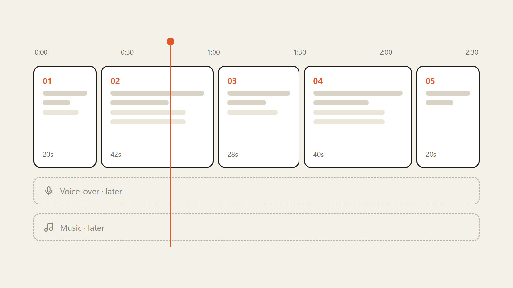

# preview-first

An [OpenFilm](https://github.com/openfilm/openfilm) skill: see the whole film before anything slow is made. Within a
few minutes the agent puts every section on the timeline at its planned length, with the words planned for it, and stops.
Where you gave photos or footage, your own are in place; a section with none is a plain placeholder card. You reorder,
retime and rewrite it in Studio. Pictures come only after you say yes, and
voice-over, music and export last.

| | | |
| --- | --- | --- |
|  | [Preview first](skills/preview-first) | The whole film as a quick placeholder preview, then pictures, then sound, each stage after you approve the last. |

It is for the film you left running overnight and found wrong in the morning, and for the hour-long run that
still isn't the film you asked for. Nothing that costs time or money happens on a structure you haven't seen.

## When the agent uses it

- You ask for an outline, a draft, a rough cut or a preview first.
- A new film will be long (over about two minutes) or will spend heavily on paid services, and nothing yet fixes its
  structure.

It stays out of the way of a short film, a recording to clean up or dub, a screen demo and a cut to music, unless you
ask for the preview, and of any request where you say to skip it.

## What the agent does

1. **Preview.** One picture per section, with the words planned for it on or beside it: your own photo or clip, trimmed
   and never re-encoded, where you gave one; otherwise a plain card with its title and what will be on screen. No
   voice-over, music, generated pictures, recordings or animated pages yet. It tells you how long the preview took.
2. **Pictures**, once you approve the preview. Whatever you changed in Studio is the new plan.
3. **Sound**, once you approve the pictures. Before the first paid `npx openfilm get`, it counts what the film will
   ask of each service you pay for (lines and characters of voice-over, minutes of music, pictures, video clips) and
   waits for your yes. OpenFilm never shows the agent prices, so you weigh the counts against your own plan. A service
   running on your own computer, and OpenFilm's own library, need no ask.
4. **Export**, only when you ask.

Say "go straight through" and it does not stop.

## Next to the canvas

OpenFilm 0.3 has a canvas, a board beside the edit that can also lay a film out as a storyboard. It holds notes and
picture or clip nodes, wired shot by shot. A node is made, and paid for, when you press Make, and nothing is on the
timeline until you send it there. The preview here is the timeline itself: your photos and clips, or plain cards, at the planned
length with the planned words, nothing made, nothing paid. A request for a storyboard of pictures to generate goes to the canvas. The two work in
order: preview first, then, at the pictures stage, the shots can be laid out on the canvas with their count first.

## Use it

- **In OpenFilm**: open Skills, add one from a link, and paste `https://github.com/WEBGRS/openfilm-preview-first`.
- **In your own agent** (Claude Code, Codex and others): `npx skills add WEBGRS/openfilm-preview-first`.

The brief is all there is: no scripts, nothing installed.

## Where the time goes

`tools/film-timing.py` reads a Claude Code session log and adds up the time per step: each tool's run time, and the
model's time before each kind of call. Use it to see which stage of your own films is slow.

```sh
python tools/film-timing.py ~/.claude/projects/<project folder>/<session>.jsonl
```

## This repository

| | |
| --- | --- |
| `skills/preview-first/` | the skill: everything in it is what the agent gets |
| `evals/README.md` | the requests it was tried on, with and without it, and what came of them |
| `evals/measure.mjs`, `evals/snap.mjs` | the scripts that measured those trials |
| `CHANGELOG.md` | what changed in each version |

## Check

```sh
node scripts/check.mjs
npm test
```

The first checks the skill the way OpenFilm's official skills are checked: name, description, brief length,
`openfilm.json` in five languages, and no stray files. The second tests the measuring script.

## 中文说明

OpenFilm 技能：先看到整条片子，再做慢的部分。几分钟内，智能体把每一段放上时间线，时长按念完这段要说的话算，话写在画面上或旁边。你给了照片或视频，画面就是你自己的原片；没有素材的段落是一张占位卡（标题、画面放什么）。然后停下。你在 Studio 里调顺序、改时长、改文字。你点头后才做画面；配音、音乐和导出放在最后。

适合这两种情况：晚上让它自己剪，早上起来发现方向就错了；或者剪了一个小时还不是你要的片子。你没看过结构之前，它不做费时或花钱的事。

**什么时候用**：你要大纲、草稿、粗剪或预览；或者一条新片子较长（超过两分钟左右），或要在付费服务上花不少钱，而且结构还没定。短片、要清理或配音翻译的录音、屏幕演示、按音乐剪的片子不用它，除非你要预览。

**三次停顿**：预览之后、画面之后、声音之后，每次都停下等你确认。你在 Studio 里改过的地方就是新的方案。说「一口气做完」就不停。

**花钱前先报用量**：第一次调用付费的 `npx openfilm get` 之前，智能体列出每个付费服务要用多少（几句配音、多少字，几分钟音乐，几张图，几段视频），等你同意。OpenFilm 不把价格告诉智能体，所以由你对照自己的套餐判断。跑在你自己电脑上的服务和 OpenFilm 自带的素材库不用问。

**和画布的关系**：OpenFilm 0.3 的画布也能把片子摆成分镜，但那是一块板：笔记加图片、视频节点，你点「生成」才做、才花钱，发送之前时间线上什么都没有。这里的预览就是时间线本身，每段一个画面（你的原片或占位卡）、写着要说的话、时长按念完算，什么都没生成、没花钱。要「生成图片的分镜」走画布；两者按顺序来：先预览，到画面阶段再在画布上摆镜头，同样先报用量。

**安装**：在 OpenFilm 的技能页点「添加 skill」，粘贴链接 `https://github.com/WEBGRS/openfilm-preview-first`；用自己的智能体（Claude Code、Codex 等）就运行 `npx skills add WEBGRS/openfilm-preview-first`。只有一份需求书，没有脚本，不装任何东西。
